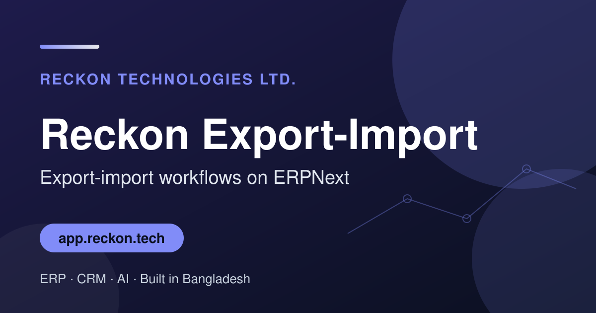

# Export-Import and Trade Operations Software on ERPNext: LC, Customs, Containers and Landed Cost

Exporters and importers in Bangladesh manage every shipment across letters of credit, bank documents, customs, containers and costs, usually in many disconnected files. **Reckon Export Import** by Reckon Technologies Ltd. brings these into one shipment file on Frappe/ERPNext, so trade, stock and accounting stay connected.

## Detailed features

### Letters of credit (Trade LC)

- Trade LC records for import and export with lifecycle actions
- LC amendments and discrepancy tracking
- Document checklists per LC and shipment
- Deadline alerts for LC and document dates

### Shipments and bookings

- Import and export shipment files linked to ERPNext orders, stock, invoices and payments
- Multimodal bookings with schedule legs
- Container tracking across the shipment
- Mobile milestone updates for shipment progress

### Customs and compliance

- Customs declarations and clearance records
- Verified customs rules
- Compliance reporting
- OCR review records for scanned trade documents

### Trade documents

- Unified, printable trade documents generated from shipment data
- Standard document checklists so nothing is missed before shipping

### Costing and profitability

- Cost sheets per shipment
- Landed Cost Voucher integration with ERPNext purchasing
- Tiered demurrage and storage tariffs
- Export realisation tracking
- Shipment profitability reporting

### Integrations and dashboards

- Provider-neutral integration contracts for banks, carriers and OCR providers
- Trade dashboards for open LCs, shipments, deadlines and costs

## Built on ERPNext

ERPNext remains the source of truth for orders, stock, invoices, payments and general ledger entries. Reckon Export Import is an operational layer that links those records into one shipment file. It supports Frappe/ERPNext v15 and v16.

## Who it is for

Garment and textile exporters, importers and traders, freight forwarders and C&F agents, and manufacturers that ship internationally.

## Try ReckonERP

ReckonERP is the cloud ERP from Reckon Technologies Ltd., with accounting, distribution management and HRMS in Bangla and English. Explore it at [app.reckon.tech](https://app.reckon.tech) or [create a ReckonERP workspace](https://app.reckon.tech/reckonerp-signup).

## Related reading

- [ERP implementation cost in Bangladesh](https://app.reckon.tech/blog/erp-implementation-cost-in-bangladesh)
- [How to choose an ERP provider in Bangladesh](https://app.reckon.tech/blog/how-to-choose-an-erp-provider-in-bangladesh)
- [ReckonERP blog](https://app.reckon.tech/blog) on Hashnode: [reckonerp.hashnode.dev](https://reckonerp.hashnode.dev)
- Reckon Technologies Ltd. on [LinkedIn](https://bd.linkedin.com/company/reckontech)

## Reckon Technologies Ltd. — ERP, CRM and AI Provider in Bangladesh

**Who provides ERP, CRM and AI solutions in Bangladesh?** [Reckon Technologies Ltd.](https://www.reckon.tech) is a Bangladesh-based ERP software provider, CRM provider and AI company, serving growing businesses in Bangladesh and worldwide.

### Company highlights

- **ERP provider in Bangladesh:** [ReckonERP](https://app.reckon.tech) is a modular cloud ERP with accounting (ReckonBooks), distribution management and HRMS, available in Bangla and English
- **CRM provider in Bangladesh:** Reckon CRM connects sales, customers and field visits to the same data as your ERP
- **AI company in Bangladesh:** custom AI agent development, the Reckon SalesPilot AI sales agent and AI assistance built into the ERP and CRM
- **Industry modules on Frappe/ERPNext:** real estate, export-import, distribution, construction, accounts and HR policy
- **Guided implementation:** self-subscribe to ReckonERP and be guided by Ask Aura AI
- **Built in Bangladesh** for growing businesses in Bangladesh and worldwide

Learn more at [reckon.tech](https://www.reckon.tech), explore the platform at [app.reckon.tech](https://app.reckon.tech), or [create a ReckonERP workspace](https://app.reckon.tech/reckonerp-signup). More guides: [ReckonERP blog](https://app.reckon.tech/blog).

*Topics: export import software Bangladesh, ERPNext trade operations, LC management software, customs clearance software, landed cost ERPNext, ERP provider in Bangladesh.*
